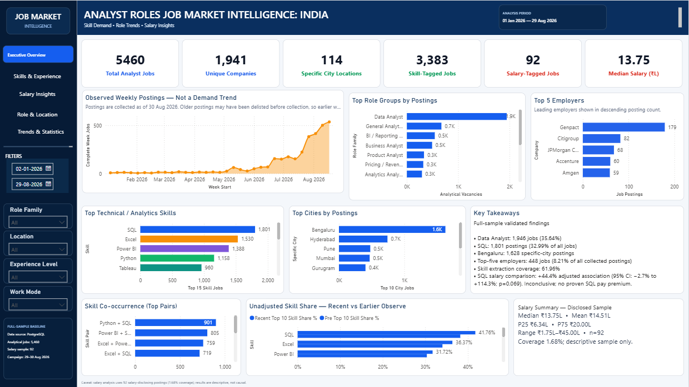
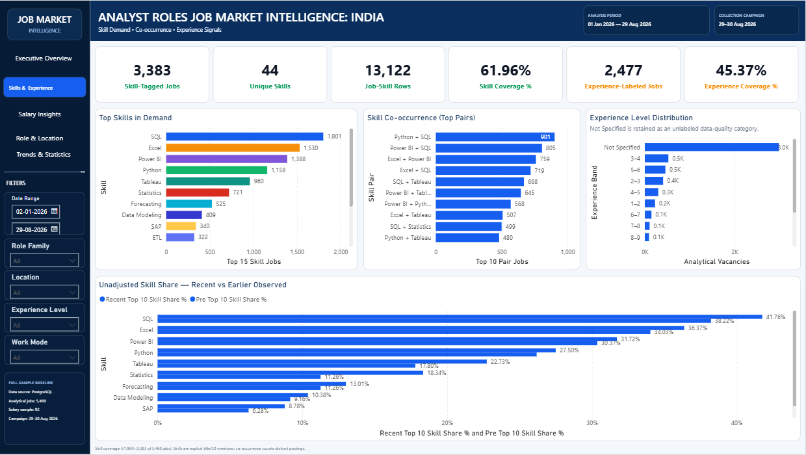
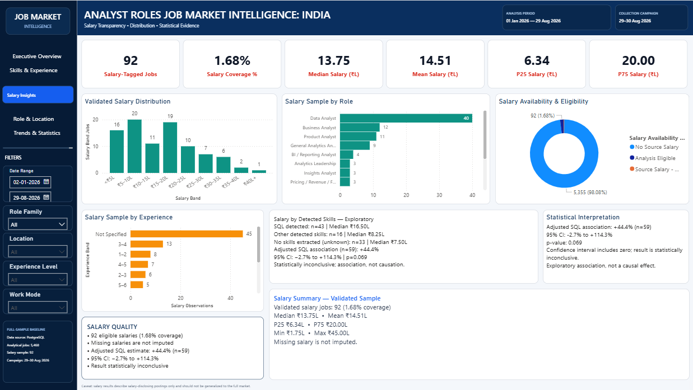
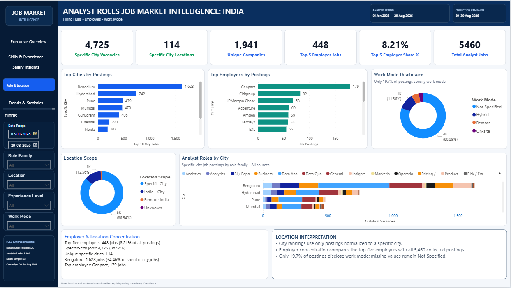
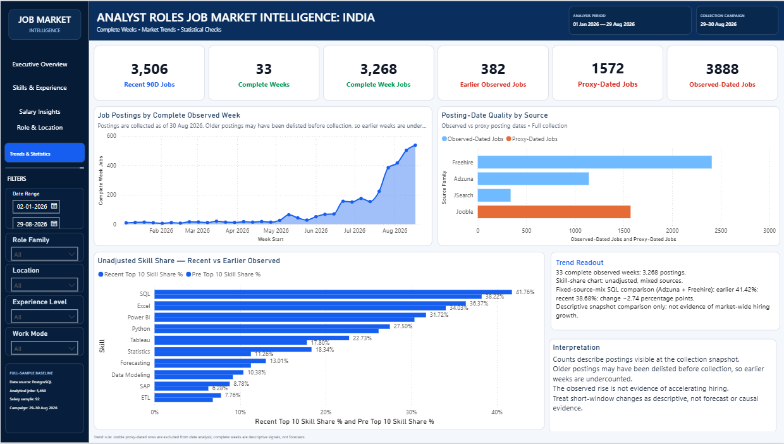
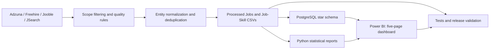

# Analyst Roles Job Market Intelligence — India

**Python · PostgreSQL · SQL · Power BI · Statistical Analysis · Data Quality**

An end-to-end analysis of **5,460 collected analyst-role job advertisements in India** from a frozen **30 August 2026** snapshot. This project converts data from four job-search providers into a cleaned analytical dataset, a PostgreSQL star schema, statistical reports, and a **five-page interactive Power BI dashboard**.

The goal is practical: help job seekers, educators, and workforce analysts understand **which analyst roles appear in the collected data, which skills are mentioned, where postings are concentrated, and what can—and cannot—be inferred from salary and posting-date evidence**.

> **Scope:** This is an *analyst roles* dataset spanning data, BI, business, product, operations, risk, and adjacent analytics roles. It is **not** a census of India's labour market or a dataset limited to the job title “Data Analyst.”

## Key Findings & Business Recommendations

| Evidence from the snapshot | Interpretation | Practical recommendation |
| --- | --- | --- |
| **Data Analyst:** 1,946 postings (**35.64%** of 5,460) | The largest role family in this collection, but other analyst titles make up most postings collectively. | Search across relevant analyst titles rather than only “Data Analyst.” |
| **SQL:** 1,801 postings; **Excel:** 1,530; **Power BI:** 1,388; **Python:** 1,158 | These are *detected mentions* in the available posting text, not mandatory skill requirements for every vacancy. | Build a demonstrable foundation in SQL and Excel, then tailor BI/Python projects to the target role. |
| **Bengaluru:** 1,628 specific-city postings; **Hyderabad:** 742 | Bengaluru accounts for **34.46%** of the 4,725 postings with a specific city; location coverage and source mix are uneven. | Use city-level results to prioritize searches, not as a measure of total city hiring. |
| **Top five employer groups:** 448 postings (**8.21%** of all 5,460) | Employer aliases were normalized; the largest group is Genpact (**179**), followed by Citigroup (**82**) and JPMorgan Chase (**68**). | Diversify employer targets; do not interpret repeated collected postings as unique vacancies at the group level without further verification. |
| **Salary disclosure:** 92 eligible postings (**1.68%**); median advertised annual midpoint **₹13.75 lakh** | Salary is missing for most postings and the disclosed subset is not representative. | Treat salary figures as descriptive evidence from disclosed advertisements only. |
| **Adjusted SQL salary association:** **+44.4%**, 95% CI **−2.7% to +114.3%**, **p = 0.069**, **n = 59** | The confidence interval includes zero; this is an *inconclusive, noncausal association*, **not proof of an SQL pay premium**. | Do not claim SQL independently raises salary based on these data. |
| **Observed posting dates:** 3,888; **proxy dates:** 1,572 | Provider mix and the disappearance of older advertisements can distort time comparisons. | Use observed-date and fixed-source comparisons; **do not claim the rising weekly chart proves market-wide hiring growth**. |

**Additional role-specific signals.** Among BI / Reporting Analyst postings, **SQL + Power BI** appears together in **68 of 544** jobs (**12.5%**). Among Data Analyst postings, **SQL + Python** appears in **331 of 1,946** (**17.0%**). A minimum-experience proxy suggests that some adjacent analyst families have a higher 0–2-year share than the Data Analyst title; this is *not* a guarantee of graduate eligibility.

## Project at a Glance

| Measure | Verified result |
| --- | ---: |
| Analytical job postings | **5,460** |
| Standardized employer groups | **1,941** |
| Specific-city postings / distinct specific-city labels | **4,725 / 114** |
| Job–skill relationships / tracked skills | **13,122 / 44** |
| Postings with at least one extracted skill | **3,383 (61.96%)** |
| Postings with an explicit experience band | **2,477 (45.37%)** |
| Eligible advertised-salary observations | **92 (1.68%)** |
| Observed-dated / proxy-dated postings | **3,888 / 1,572** |
| Complete observed weeks / postings in those weeks | **33 / 3,268** |
| Power BI report pages / KPI card visuals | **5 / 30** |
| Automated tests | **29 tests and 55 subtests passed** |
| Full analytical and Power BI validation | **PASS** (7 November 2026) |

## Power BI Dashboard — All Five Pages

**[Open the interactive Power BI report (`.pbix`)](dashboard/DataAnalystJobMarketIntelligence.pbix)** — view the screenshots below directly on GitHub; the `.pbix` can be opened in Power BI Desktop. The saved imported model can be viewed without reconnecting to the database, while **refreshing** the model requires the project PostgreSQL data source.

### 1. Executive Overview

A one-page briefing on job volume, employer groups, cities, skill coverage, salary coverage, leading roles, top employers, and key findings. The weekly chart is explicitly labeled **“Not a Demand Trend.”**



### 2. Skills & Experience

Ranked skill mentions, co-occurring skill pairs, experience bands, and an **unadjusted** recent-versus-earlier skill-share comparison. The “Not Specified” experience group remains visible to disclose missing data.



### 3. Salary Insights

A properly ordered salary-band distribution and breakdowns by role, experience and extracted-skill evidence. The dashboard clearly states that the **59-record adjusted SQL association is statistically inconclusive**.



### 4. Role & Location

Specific-city and employer-group concentration, analyst-role mix across major cities, and **work-mode disclosure**. After employer alias and city-label cleanup, the KPIs show **1,941 employer groups**, **114 specific cities** and **4,725 specific-city postings**.



### 5. Trends & Statistical

Complete observed-week counts, observed-versus-proxy posting-date quality by provider, and recent-versus-earlier skill shares. A **fixed-source-mix SQL comparison** reports **41.42% earlier versus 38.68% recent (−2.74 percentage points)**; this remains descriptive, **not evidence of declining market demand**.



## End-to-End Pipeline



**Collection and processing.** The acquisition window was **1 January–29 August 2026**, with a collection campaign on **29–30 August 2026**. The recorded source breakdown of the **retained** postings is Freehire **2,407**, Jooble **1,572**, Adzuna **1,143**, and JSearch **338**. The historical collection summary records **104,079 raw candidate records**, but original API responses are **not redistributed**; that upstream total cannot be independently recomputed from this repository.

**Cleaning and entity resolution.** Rules filter out-of-scope titles, flag date provenance, standardize reviewed company aliases (including Citi/Citigroup, JPMorgan variants, and Amgen variants), remove state-only and `Unknown` labels from the specific-city measure, and deduplicate conservatively. None of these display-name corrections remove rows from the **5,460-job frozen snapshot**.

**Feature engineering.** Reporting fields include role family, job seniority, minimum stated experience, experience band, specific-city/location scope, work-mode disclosure, skill flags, salary eligibility, observed-versus-proxy date provenance, recent observed period, and complete-week eligibility. **44 keyword/regex skill definitions** generate a many-to-many job–skill bridge.

**Salary methodology.** Only eligible disclosed INR salary ranges are annualized and summarized using their midpoints. The exploratory regression models log advertised salary against SQL detection and available source/seniority/experience controls using an HC3-robust confidence interval; because the sample is small and selective, this is **not a causal or representative pay estimate**. Details: [`salary_regression_summary.txt`](reports/salary_regression_summary.txt) and [`salary_skill_evidence.csv`](reports/salary_skill_evidence.csv).

## Data Model and Tech Stack

The PostgreSQL model uses **one fact table, five dimensions, one job–skill bridge and reporting views**:

| Model component | Purpose |
| --- | --- |
| `job_market.fact_jobs` | One record per retained posting; role, employer, location, date, salary and quality keys/attributes |
| `dim_role`, `dim_company`, `dim_location`, `dim_date`, `dim_skill` | Standardized lookup entities |
| `job_market.bridge_job_skill` | Many-to-many connections between jobs and extracted skills |
| `vw_jobs_enriched`, `vw_job_skills` | Reporting-friendly joined views |

| Workstream | Technologies and methods |
| --- | --- |
| Data collection and processing | Python, Pandas, NumPy, API integrations, regex, conservative record matching |
| Database and analysis | PostgreSQL, SQL joins, CTEs, aggregations, ranking and percentiles |
| Statistics | Descriptive comparisons, source-mix checks, exploratory log-salary regression, robust confidence intervals |
| BI and communication | Power BI, DAX measures, five-page visual narrative |
| Testing and integrity | Pytest, release validation, duplicate/key checks, CSV–PBIX consistency checks, SHA-256 manifest |

See [`sql/schema.sql`](sql/schema.sql) for the model and [`sql/analysis_queries.sql`](sql/analysis_queries.sql) for the SQL analysis.

## How to Run or Review

### Fastest option — inspect the published analysis

1. Review the **five screenshots above** on GitHub.
2. Open [`dashboard/DataAnalystJobMarketIntelligence.pbix`](dashboard/DataAnalystJobMarketIntelligence.pbix) in **Power BI Desktop** to explore filters and visuals.
3. Review the evidence in [`reports/`](reports/) and the exploratory notebook [`notebooks/analysis.ipynb`](notebooks/analysis.ipynb).

### Reproduce analysis and verification locally

**Windows PowerShell (Python 3.12 recommended):**

```powershell
py -3.12 -m venv .venv
.\.venv\Scripts\python.exe -m pip install -r requirements.txt

# Unit tests
.\.venv\Scripts\python.exe -m pytest -q

# Check the frozen datasets, reports and Power BI semantic-model snapshot
.\.venv\Scripts\python.exe -u scripts\validate_analysis.py --scope all
```

The validated result for the submitted snapshot was **29 passed, 55 subtests passed**, followed by **`status: PASS`** for the full analytical validation. The validator compares hashes with [`config/dataset_lock.json`](config/dataset_lock.json), so a deliberate change to tracked datasets, the PBIX or screenshots must be reviewed and re-locked before a new release.

To regenerate the **derived analysis reports** from the included processed tables:

```powershell
.\.venv\Scripts\python.exe scripts\build_report_outputs.py
```

> **Do not run the raw-data builder expecting to reproduce this exact freeze.** The original raw API export is absent. A new collection requires provider credentials and creates a different snapshot. See [`DATA_SOURCE.md`](DATA_SOURCE.md) and [`RUN_GUIDE.md`](RUN_GUIDE.md) for source and workflow context.
>
> **Database caution:** [`scripts/load_to_postgres.py`](scripts/load_to_postgres.py) uses a schema script that **drops and recreates** objects. Run it only against a dedicated, disposable project database—not a shared database. Opening the existing PBIX does not require rerunning this loader.

## Repository Guide

```text
.
├── config/                         # Frozen dataset specifications and hashes
├── dashboard/
│   ├── DataAnalystJobMarketIntelligence.pbix
│   └── screenshots/               # The five images embedded above
├── data/
│   ├── processed/                 # Jobs + job–skill bridge CSVs
│   └── raw/README.md             # Raw source availability notes
├── notebooks/analysis.ipynb      # Exploratory analysis
├── reports/                      # Analytical tables, evidence and figures
├── scripts/                      # Collection, cleaning, reporting, validation
├── sql/                          # PostgreSQL schema and analysis queries
├── tests/                        # Automated tests
├── DATA_SOURCE.md                # Collection and provenance documentation
├── RUN_GUIDE.md                  # Additional local execution guidance
├── requirements.txt
└── README.md
```

## Limitations and What Is Not Yet Claimed

- **Collection bias:** Results describe advertisements visible to four providers during a short collection campaign; they do not estimate the total number of unique vacancies or market-wide demand in India.
- **Date provenance:** **1,572 Jooble records use update-time proxies**, excluded from observed-date comparisons. Earlier job ads may have disappeared before the collection date. A rising observed-week series is **not** proof of hiring acceleration.
- **Missing skills and experience:** Skill extraction covers **61.96%** of postings and depends on a fixed 44-term dictionary; absent mentions are not proof that a skill was unnecessary. Experience data are incomplete.
- **Salary selection and uncertainty:** Only **92/5,460** postings have eligible disclosed salary. The **n = 59** adjusted SQL analysis is exploratory, with a confidence interval crossing zero; no causal salary premium is asserted. A documented multi-specification robustness table is still a potential extension.
- **Role-taxonomy validation:** The current AI-assisted review material is **not an independent human-labeled 50-kept/50-excluded audit**. Accordingly, no independently verified precision or recall is claimed. Human review of both retained and rejected roles is needed.
- **Geographic aggregation:** The main dashboard ranks **specific city names**. A separate metro-area comparison (for example, Delhi NCR or Hyderabad Metro) is a possible future view; it is **not** represented as already delivered on the city chart.
- **Rebuilding from source:** The processed snapshot, validation files and PBIX are included, but raw API payloads and job-description content are not redistributed; historical raw-row and exclusion totals remain log-derived.

## Supporting Evidence

- [`reports/salary_regression_summary.txt`](reports/salary_regression_summary.txt) — adjusted salary model and uncertainty
- [`reports/source_period_skill_summary.csv`](reports/source_period_skill_summary.csv) — period/source comparisons
- [`reports/city_demand_summary.csv`](reports/city_demand_summary.csv) — normalized specific-city counts
- [`reports/company_demand_summary.csv`](reports/company_demand_summary.csv) — normalized employer-group counts
- [`config/dataset_lock.json`](config/dataset_lock.json) — frozen counts and SHA-256 checksums
- [`DATA_SOURCE.md`](DATA_SOURCE.md) — collection, provenance and data limitations

---

**Project status:** Frozen processed dataset, analytical reports and the saved five-page Power BI model were reconciled; **29 tests and 55 subtests passed**, and `validate_analysis.py --scope all` returned **`status: PASS` on 7 November 2026**. This statement describes the verified local snapshot, not a live or continuously updating job feed.
